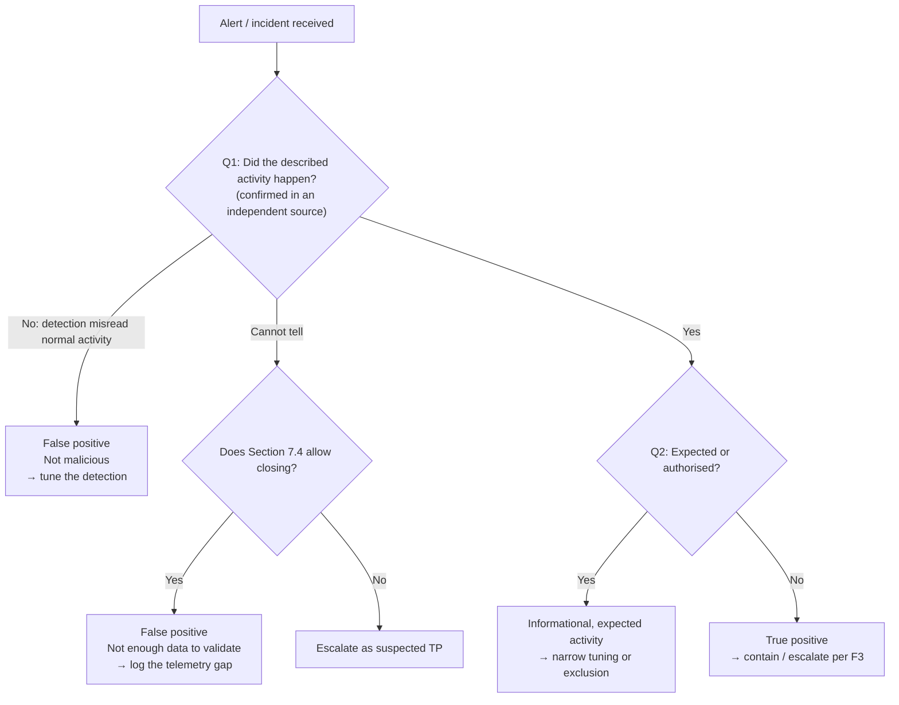

# SOP-001: Alert and Incident Triage

| Field | Value |
|---|---|
| **SOP ID** | SOP-001 |
| **Title** | Alert and Incident Triage: Verdict, Corroboration and Prioritisation |
| **Version** | 1.0 |
| **Status** | Active |
| **Owner** | Vince-SecOperations |
| **Effective date** | 2026-11-22 |
| **Next review** | 2027-05-22 |
| **Primary platform** | Microsoft Defender XDR (unified portal, with Microsoft Sentinel) |
| **Applies to** | Any SIEM/XDR platform (see the platform mapping tables) |

---

## 1. Purpose

This SOP defines one repeatable method for triaging every alert and incident in this lab and in every case file in this repository. It answers three questions in a fixed, defensible way:

| Framework | Question it answers | Output |
|---|---|---|
| **F1: The Verdict Test** | *What is it?* | Classification + determination |
| **F2: Pivot & Corroborate** | *Is it real?* | Independent evidence for or against the alert |
| **F3: The Triage Clock** | *How fast, and who decides?* | Priority, SLA timebox, escalate-or-close decision |


## 2. Scope

- **In scope:** vendor alerts, custom detection rules, correlated incidents (multi-alert), and alerts from any connected source (endpoint, identity, email, cloud apps, network).
- **Out of scope:** full forensic investigation, containment playbooks and post-incident review. Those start *after* this SOP produces a true positive or an escalation.

## 3. Definitions

| Term | Definition |
|---|---|
| **Alert** | A signal that a detection rule's logic matched data. It is a hypothesis, not a fact. |
| **Incident** | A container of correlated alerts and entities describing one suspected attack story. Triage the story, not just the top alert. |
| **True positive (TP)** | The activity the alert describes happened, and it was not authorised. |
| **Benign positive (BP)** | The activity the alert describes happened, but it was expected or authorised. In Defender XDR this is *Informational, expected activity*. |
| **False positive (FP)** | The activity the alert describes did not happen as claimed: the detection misread normal activity. |
| **Outcome** | Whether malicious activity succeeded, was blocked or is ongoing. **Outcome affects severity and response, never the verdict.** |
| **Independent source** | A data source other than the one that generated the alert. |
| **Asset tier** | The business criticality of the affected asset (Section 7.1). |

---

## 4. Run order

The three frameworks are numbered by the question they answer. They are **run** in this order:

```
1. F3 – Start the clock    → set initial priority and timebox at intake
2. F2 – Pivot & Corroborate → gather independent evidence inside the timebox
3. F1 – Verdict Test        → classify using the evidence
4. F3 – Decide              → re-prioritise, then close, contain or escalate
```

---

## 5. F1: The Verdict Test

### 5.1 Decision questions (always in this order)

| # | Question | Answer | Verdict |
|---|---|---|---|
| Q1 | Did the activity the alert describes actually happen, confirmed in an **independent source** (F2)? | **No**: the detection misread normal activity | **False positive: Not malicious** |
| | | **Cannot tell**: telemetry is missing or insufficient | **False positive: Not enough data to validate**, *only if Section 7.4 allows it*; otherwise **escalate** |
| Q2 | It happened. Was it **expected or authorised**? (Change ticket, pentest or red-team schedule, known business application, user confirmation.) | **Yes** | **Informational, expected activity** |
| Q3 | It happened, and it was not authorised. | — | **True positive** |

### 5.2 Decision flow



### 5.3 Rules

1. **Classification measures the detection; outcome measures the impact.** A blocked command-and-control connection is still a **true positive**. Record "blocked" as the outcome, not as a reason to close.
2. **"No evidence found" is not "false positive."** You must either show the benign root cause (FP: Not malicious) or state the telemetry gap (FP: Not enough data to validate).
3. **Benign positives require proof of authorisation** (ticket, schedule, owner confirmation), not an assumption.
4. **Triage the incident, not only the alert.** Order alerts chronologically by first activity. One true positive alert inside an incident makes the incident a true positive.

### 5.4 Defender XDR field mapping

| Verdict | Classification | Determination options |
|---|---|---|
| TP | True positive | Multistage attack · Malicious user activity · Compromised account · Malware · Phishing · Unwanted software · Other |
| BP | Informational, expected activity | Security test · Line-of-business application · Confirmed activity · Other |
| FP | False positive | Not malicious · Not enough data to validate · Other |

### 5.5 Required follow-up by verdict

| Verdict | Required action |
|---|---|
| TP | Contain or escalate per F3; open the investigation case file. |
| BP | Add the narrowest possible exclusion (specific account + host + process + time window), never a broad suppression. Record the authorisation reference. |
| FP: Not malicious | Record the root cause in detection terms (which condition matched and why it was wrong); raise a tuning change for the rule. |
| FP: Not enough data | Record which log source was missing; raise a telemetry gap item. |

### 5.6 Equivalents on other platforms

| Platform | Where the verdict is recorded |
|---|---|
| Microsoft Defender XDR | Classification + Determination |
| Microsoft Sentinel | Closing classification (True positive, Benign positive, False positive, Undetermined) + comment |
| Splunk Enterprise Security | Notable event status + disposition + comment |
| Any ticketing/SOAR | Resolution code + resolution notes |

---

## 6. F2: Pivot & Corroborate

### 6.1 Procedure

| Step | Action | Detail |
|---|---|---|
| **0. Read the detection** | **Custom rule:** re-run the rule's own query over the alert window and read exactly which rows matched. **Vendor alert:** read the evidence, the "what happened" description and the MITRE mapping. | Many false positives are decided here: you see which condition matched. |
| **1. Extract entities** | List every entity: device, IP, account, process/file (with hash), URL, domain, mailbox. | Incident Assets and Evidence tabs. |
| **2. Set the time window** | From the incident's **first activity minus 1 hour** to **last activity plus 1 hour**. Start tight; widen only to look for earlier activity or persistence. | Advanced hunting uses **UTC**. Convert the portal display time before querying. Defender tables use `Timestamp`; Sentinel tables use `TimeGenerated`. |
| **3. Query an independent source** | Corroborate the alert's claim in a table or source that did not generate it. | See 6.2. |
| **4. Answer three questions** | (a) Did it happen? (b) Did it succeed, fail or get blocked? (c) What started it (process, account, parent)? | These feed F1 and F3. |

### 6.2 Pivot map: alert type → where to corroborate

| Alert type | Defender XDR tables | Sentinel tables | Other platforms |
|---|---|---|---|
| Endpoint: process / execution | `DeviceProcessEvents`, `DeviceImageLoadEvents` | `SecurityEvent` (4688), Sysmon (`Event`) | Sysmon Event ID 1, EDR process telemetry |
| Endpoint: network / C2 | `DeviceNetworkEvents` | `CommonSecurityLog` (firewall), `AzureNetworkAnalytics_CL` | Sysmon Event ID 3, firewall/proxy logs |
| Endpoint: file | `DeviceFileEvents` | Sysmon (`Event`) | Sysmon Event ID 11 |
| Identity: on-premises | `IdentityLogonEvents`, `IdentityDirectoryEvents`, `IdentityQueryEvents` | `SecurityEvent` (4624, 4625, 4768, 4769) | Windows Security log |
| Identity: cloud sign-in | `EntraIdSignInEvents`, `IdentityInfo` | `SigninLogs`, `AADNonInteractiveUserSignInLogs` | IdP sign-in logs |
| Email | `EmailEvents`, `EmailUrlInfo`, `UrlClickEvents`, `EmailAttachmentInfo` | `OfficeActivity` | Mail gateway logs |
| Cloud apps / SaaS | `CloudAppEvents` | `OfficeActivity`, `AuditLogs` | CASB / SaaS audit logs |
| Enrichment (any type) | `DeviceInfo`, `IdentityInfo`, `AlertInfo`, `AlertEvidence` | `SecurityAlert`, `ThreatIntelligenceIndicator` | CMDB, threat intelligence platform |

> Use the **Schema** tab in Advanced hunting to confirm table and column names available in your tenant before writing a pivot.

### 6.3 Query templates (Defender XDR advanced hunting)

**Network corroboration**

```kql
let start = datetime(YYYY-MM-DD HH:MM:SS);   // first activity minus 1h (UTC)
let end   = datetime(YYYY-MM-DD HH:MM:SS);   // last activity plus 1h (UTC)
let ioc_ip = "x.x.x.x";
DeviceNetworkEvents
| where Timestamp between (start .. end)
| where RemoteIP == ioc_ip
| summarize Connections = count(), First = min(Timestamp), Last = max(Timestamp)
    by DeviceName, ActionType, InitiatingProcessFileName,
       InitiatingProcessCommandLine, InitiatingProcessAccountName, RemotePort
| order by Connections desc
```

**Process corroboration**

```kql
let start = datetime(YYYY-MM-DD HH:MM:SS);
let end   = datetime(YYYY-MM-DD HH:MM:SS);
let host  = "device-name";
DeviceProcessEvents
| where Timestamp between (start .. end)
| where DeviceName =~ host
| project Timestamp, AccountName, InitiatingProcessFileName,
          FileName, ProcessCommandLine, SHA256
| order by Timestamp asc
```

**Identity corroboration**

```kql
let start = datetime(YYYY-MM-DD HH:MM:SS);
let end   = datetime(YYYY-MM-DD HH:MM:SS);
let upn   = "user@domain.com";
IdentityLogonEvents
| where Timestamp between (start .. end)
| where AccountUpn =~ upn
| summarize Attempts = count(), First = min(Timestamp), Last = max(Timestamp)
    by ActionType, LogonType, Protocol, DeviceName, IPAddress, FailureReason
| order by First asc
```

### 6.4 Rules

1. **Never classify from the alert title alone.** At least one independent source must support the verdict.
2. **Always bound queries by time and by entity.**
3. **Record the exact queries used** in the case file, so the verdict can be reproduced.
4. **Read patterns, not just hits:** perfectly regular timestamps (for example, starting exactly on the hour) suggest scheduled jobs; regular intervals with small payloads suggest beaconing. Check both before deciding.

---

## 7. F3: The Triage Clock

### 7.1 Asset tiers

| Tier | Description | Lab examples |
|---|---|---|
| **Tier 0** | Identity and control plane | Domain controllers, Entra ID admin accounts, privileged access systems |
| **Tier 1** | Production business systems and sensitive data | Customer-facing servers, databases, file servers holding PII |
| **Tier 2** | Standard user endpoints | Employee workstations and laptops |
| **Tier 3** | Non-production | Dev/test servers, lab machines with no production data |

In Defender XDR, record criticality using critical asset classification (Exposure Management) or device value; otherwise use the CMDB.

### 7.2 Priority matrix

Start from **alert/incident severity × asset tier**:

| Severity ↓ / Tier → | Tier 0 | Tier 1 | Tier 2 | Tier 3 |
|---|---|---|---|---|
| **High** | P1 | P1 | P2 | P3 |
| **Medium** | P1 | P2 | P3 | P4 |
| **Low** | P2 | P3 | P4 | P4 |
| **Informational** | P3 | P4 | P4 | P4 |

**Modifiers** (apply once each, maximum one level up or down in total):

- **Raise one level** if: multi-stage incident, a privileged account is involved, a late kill-chain stage is present (command and control, exfiltration, impact), or the activity is still ongoing.
- **Lower one level** if: the activity is confirmed blocked **and** there is no follow-on activity in the window.

### 7.3 SLA timebox (lab defaults)

| Priority | Acknowledge within | Verdict or escalate within | Example |
|---|---|---|---|
| **P1** | 15 min | 30 min | Active C2 on a production server |
| **P2** | 30 min | 2 h | Suspicious sign-in on a privileged account |
| **P3** | 4 h | 8 h | Unwanted software on a workstation |
| **P4** | 1 business day | 3 business days | Informational alert on a test box |

> These values are lab defaults. Real SLA targets are set by each organisation's policy or each MSSP client contract; adjust this table rather than the method.

### 7.4 Escalate-or-close rules

1. **Escalate on uncertainty, close only on evidence.**
2. **"FP: Not enough data to validate" may only be used for P3/P4 on Tier 2/3 assets.** For P1/P2 or Tier 0/1, missing data means **escalate as a suspected true positive**.
3. **If the timebox expires without a verdict, escalate.** Do not extend the timebox silently.
4. **Re-run the priority matrix after F1.** A confirmed TP on a Tier 0/1 asset is P1 regardless of the initial priority.

### 7.5 Clock metrics recorded per case

| Metric | Measured from → to |
|---|---|
| **Time to detect (TTD)** | First activity → alert/incident created |
| **Time to acknowledge (TTA)** | Incident created → analyst assigned |
| **Time to verdict (TTV)** | Analyst assigned → classification set |
| **Time to respond (TTR)** | Classification set → containment or closure |

---

## 8. Closing note standard

Every resolved alert or incident carries a comment in this format:

```
VERDICT: <True positive | Informational, expected activity | False positive> / <Determination>
OUTCOME: <Succeeded | Blocked | Failed | Ongoing | N/A>
PRIORITY: <P1–P4> (Severity <x> × Tier <n>, modifiers: <list or none>)
EVIDENCE: <independent source(s) and key finding, one line each>
ROOT CAUSE / AUTHORISATION: <for FP: what the rule matched and why; for BP: ticket/schedule reference>
FOLLOW-UP: <tuning change | exclusion | telemetry gap | escalated to Tier 2/IR | none>
METHOD: SOP-001 v1.0 (F1, F2, F3)
```

---

## 9. References

- Microsoft Learn: Incident resource type (classification and determination values)
- Microsoft Learn: Manage incidents in Microsoft Defender
- Microsoft Learn: Advanced hunting schema reference
- Microsoft Learn: Advanced hunting with Microsoft Sentinel data in the Defender portal
- MITRE ATT&CK: https://attack.mitre.org


## Revision history

| Version | Date | Author | Change |
|---|---|---|---|
| 1.0 | 2026-11-22 | Vince-SecOperations | Initial release: F1 Verdict Test, F2 Pivot & Corroborate, F3 Triage Clock |
