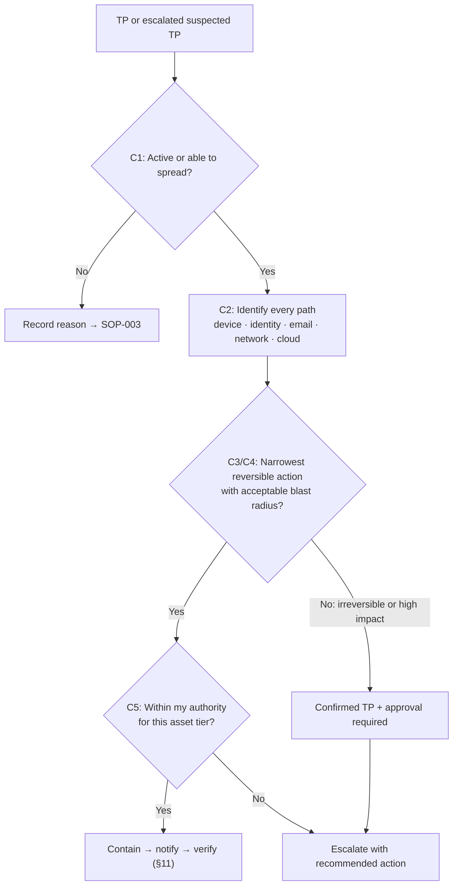

# SOP-002: Containment

| Field | Value |
|---|---|
| **SOP ID** | SOP-002 |
| **Title** | Containment: Decision, Authority and Verification |
| **Version** | 1.0 |
| **Status** | Active |
| **Owner** | Vince-SecOperations |
| **Effective date** | 2026-11-22 |
| **Next review** | 2027-05-22 |
| **Primary platform** | Microsoft Defender XDR (unified portal, with Microsoft Sentinel and Microsoft Entra ID) |
| **Environments** | On-premises, hybrid (AD + Entra ID) and cloud workloads |
| **Preceded by** | [SOP-001: Alert and Incident Triage](SOP-001-Alert-and-Incident-Triage.md) |
| **Followed by** | [SOP-003: Eradication, Remediation and Recovery](SOP-003-Eradication-Remediation-and-Recovery.md) |

---

## 1. Purpose

This SOP defines **when** to contain, **what** action to take, **who** is authorised to take it, and **how** to prove it worked. It sets rules and authority. Scenario-specific steps (phishing, business email compromise, ransomware, cloud key leak) belong in runbooks that must operate inside these rules.

## 2. Scope

- **In scope:** every true positive, and every suspected true positive escalated under SOP-001 §7.4, regardless of detection source (vendor alert, custom detection rule, threat hunt, user report).
- **Out of scope:** removing the attacker's foothold, fixing the root cause and restoring service (SOP-003).

## 3. Framework alignment

| Activity | NIST CSF 2.0 | Covered by |
|---|---|---|
| Triage and validate | RS.MA-02 | SOP-001 |
| Categorise and prioritise | RS.MA-03 | SOP-001 |
| Escalate or elevate | RS.MA-04 | SOP-001 §7.4 |
| **Contain** | **RS.MI-01** | **SOP-002** |
| Eradicate | RS.MI-02 | SOP-003 |
| Apply recovery criteria / recover | RS.MA-05, RC.RP | SOP-003 |

Reference model: NIST SP 800-61 Rev. 3 (April 2025), the incident response profile of CSF 2.0.

## 4. Definitions

| Term | Definition |
|---|---|
| **Containment** | An action that stops the incident from spreading or causing further damage, without yet removing the cause. |
| **Short-term containment** | Immediate, reversible action to stop harm (isolate a device, revoke sessions, block an indicator). |
| **Long-term containment** | Temporary controls kept in place while eradication is prepared (firewall rules, conditional access block, restricted app execution). |
| **Blast radius** | The business impact of the containment action itself (for example, isolating a production server stops customer service). |
| **Reversible action** | An action that can be fully undone with no data loss (isolate/release, disable/enable, block/unblock). |
| **Pre-approved action** | An action the authority matrix (§7) allows a role to take without further approval. |
| **Asset tier** | As defined in SOP-001 §7.1 (Tier 0 identity/control plane → Tier 3 non-production). |

---

## 5. Entry criteria

Containment may start when **any** of the following is true:

1. SOP-001 verdict is **true positive**.
2. SOP-001 escalated a **suspected true positive** at P1/P2 **and** there is evidence of ongoing or spreading activity.
3. An automated action has already been taken (§9) and must be validated by an analyst.

> **Suspected is enough for reversible actions.** When the cost of waiting is higher than the cost of a reversible action, contain first and finish the investigation after. Irreversible actions require a confirmed true positive.

---

## 6. The Containment Decision Test

Answer in order. Record the answers in the case file.

| # | Question | Guides |
|---|---|---|
| **C1** | **Is it active or able to spread?** (Ongoing C2, lateral movement, active session, malicious email still in mailboxes, valid stolen credential.) | If **no** (single blocked event, no follow-on activity): containment may not be needed. Record why and move to SOP-003. |
| **C2** | **What must be cut?** Identify the attacker's path: device, identity, email, network indicator, cloud resource. | Choose actions that cut **every** path; containing the device but not the stolen account leaves the attacker in. |
| **C3** | **What is the blast radius of the action?** | Tier 0/1 assets: business owner must be informed or approve (§7). Prefer the narrowest action that stops the harm. |
| **C4** | **Is the action reversible?** | Reversible → can proceed on suspected TP. Irreversible (hard delete, wipe, account deletion) → confirmed TP and approval only. |
| **C5** | **Do I hold authority for this action on this tier?** | Check §7. If not → escalate with a recommended action. Never act outside authority, even under time pressure. |

### 6.1 Decision flow



---

## 7. Authority matrix

**Legend:** ✅ pre-approved · 🔔 pre-approved, notify asset owner immediately · 🟡 requires L2/L3 or IR lead approval · 🔴 requires incident commander **and** business owner approval · ❌ not permitted

### 7.1 Tier 2/3 assets (workstations, non-production, standard users)

| Action | L1 | L2 | L3 / IR lead |
|---|---|---|---|
| Stop and quarantine file | ✅ | ✅ | ✅ |
| Block indicator (hash, URL, domain) | ✅ | ✅ | ✅ |
| Soft-delete malicious email across mailboxes | ✅ | ✅ | ✅ |
| Collect investigation package | ✅ | ✅ | ✅ |
| Isolate device (full or selective) | 🔔 | ✅ | ✅ |
| Revoke sessions / require re-sign-in | 🔔 | ✅ | ✅ |
| Mark user as compromised (Entra risk = high) | 🟡 | ✅ | ✅ |
| Reset password / reset authentication | 🟡 | 🔔 | ✅ |
| Disable user account | 🟡 | 🔔 | ✅ |
| Restrict app execution | 🟡 | ✅ | ✅ |
| Block IP address or range | 🟡 | ✅ | ✅ |
| Hard-delete email | ❌ | 🟡 | ✅ |
| Live response (run scripts, remove files) | ❌ | 🟡 | ✅ |

### 7.2 Tier 0/1 assets (identity infrastructure, production, privileged accounts)

| Action | L1 | L2 | L3 / IR lead |
|---|---|---|---|
| Collect investigation package | ✅ | ✅ | ✅ |
| Block indicator (hash, URL, domain) | ✅ | ✅ | ✅ |
| Stop and quarantine file | 🟡 | 🔔 | ✅ |
| Revoke sessions (privileged account) | 🟡 | 🔔 | ✅ |
| Isolate production server (Tier 1) | ❌ | 🟡 | 🔴 |
| Disable privileged / service account | ❌ | 🟡 | 🔴 |
| Any action on a domain controller or identity system (Tier 0) | ❌ | ❌ | 🔴 |
| Mass action (more than 10 devices or users) | ❌ | 🟡 | 🔴 |
| Disable emergency access (break-glass) account | ❌ | ❌ | ❌ |

### 7.3 Rules

1. **The matrix is the ceiling, not the target.** Take the narrowest action that stops the harm.
2. **Time pressure does not widen authority.** If an action is outside your authority, escalate with a recommended action and the evidence; record the time you escalated.
3. **Notify means immediately**, by the channel defined for the asset owner, not at shift end.
4. **Never disable break-glass accounts or the accounts running the security tooling.** Restrict and monitor them instead, under IR lead direction.

---

## 8. Containment actions by environment

| Path | On-premises / hybrid | Cloud (Entra ID / Microsoft 365) | Cloud workloads (Azure / AWS / GCP VMs) |
|---|---|---|---|
| **Device** | Defender: isolate device, restrict app execution, contain device (for devices not onboarded) | — | Defender isolation if onboarded; otherwise network security group / security group / firewall rule allowing only management traffic. **Snapshot the disk first.** |
| **Identity** | Disable in AD (Defender for Identity action or AD directly); reset password | Revoke sessions, mark compromised, disable in Entra ID, block sign-in with conditional access | Disable/rotate cloud IAM credentials, access keys, service principal secrets |
| **Email** | — | Soft-delete across mailboxes, block sender/domain in Tenant Allow/Block List, remove malicious inbox rules and forwarding | — |
| **Network** | Firewall/proxy block | Defender custom indicators (IP, URL, domain) | Cloud firewall / security group deny rules |

### 8.1 Hybrid identity rules

1. **Disabling or resetting in on-premises AD does not take effect in Entra ID until the next directory sync.** Also act in Entra ID: revoke sessions and block sign-in.
2. **A password reset does not end existing sessions or tokens.** Always pair a reset with revoke sessions.
3. **Check for attacker-added persistence on the identity**: new MFA methods, app consents, mailbox rules, group memberships. Record findings for SOP-003; remove only under SOP-003 unless they enable ongoing access, in which case remove now.

---

## 9. Detection source and automation

The containment rules are the **same** for vendor alerts and custom detections. What differs is automation.

### 9.1 Vendor alerts

1. **Check the Action Center first.** Automated investigation and response, or automatic attack disruption, may already have contained devices or users.
2. **Validate, don't duplicate or undo.** Confirm each automated action fits the evidence; record it as a containment action in the case file.
3. **If an automated action caused unacceptable business impact**, escalate to L2/L3 before reversing it.

### 9.2 Custom detection rules

Custom detection rules in Defender XDR can carry automated response actions (isolate device, collect investigation package, run antivirus scan, initiate investigation, restrict app execution, quarantine or block file, mark user compromised, disable user, reset user authentication, move or delete email).

An automated action may be attached to a custom rule **only if all** of the following are true:

| # | Condition |
|---|---|
| 1 | The rule has run in alert-only mode for a tuning period (lab default: 30 days) with **no false positives**. |
| 2 | The action is **reversible** and appears in the L1 ✅ column of §7.1. |
| 3 | The rule is scoped to **Tier 2/3 device groups**. Never auto-isolate or auto-disable Tier 0/1. |
| 4 | The rule and action are documented (rule name, query version, action, owner, review date). |
| 5 | Every automated action still raises an alert that an analyst reviews under this SOP. |

---

## 10. Evidence before and during containment

1. **Collect the investigation package before or immediately after isolating.** Isolation keeps the device connected to Defender, so collection still works.
2. **Do not power off or reboot** a compromised device unless the IR lead directs it; memory evidence is lost.
3. **Snapshot cloud VM disks** before changing network rules or stopping instances.
4. **Record the exact time of each action (UTC).** It is the reference point for verification (§11).

---

## 11. Verify containment

Containment is not complete until a query shows the activity stopped.

```kql
// Did activity continue after containment? Expect zero rows.
let contained_at = datetime(YYYY-MM-DD HH:MM:SS);   // time of containment action (UTC)
let ioc_ip = "x.x.x.x";
let host   = "device-name";
DeviceNetworkEvents
| where Timestamp > contained_at
| where RemoteIP == ioc_ip or DeviceName =~ host
| where ActionType == "ConnectionSuccess"
| project Timestamp, DeviceName, RemoteIP, RemotePort, InitiatingProcessFileName
```

For identity containment, verify that no successful sign-ins occurred after the revoke or disable time (`EntraIdSignInEvents` / `IdentityLogonEvents`). For cloud workloads, verify through flow logs or provider audit logs.

**If activity continues:** a path was missed (C2). Return to §6.

---

## 12. Communication

| Audience | When | Content |
|---|---|---|
| Asset owner | On every 🔔 / 🔴 action | What was contained, why, expected impact, contact |
| Affected user | After identity containment | Account action taken, what to expect, how to verify contact is genuine |
| Incident commander / IR lead | On every P1, any Tier 0/1 action | Status, actions, open risks |
| Client (MSSP) | Per contract notification SLA | See §13 |

---

## 13. MSSP operation

1. **Each client has its own rules of engagement**: the list of response actions the provider is authorised to take, on which asset groups, and who approves anything else.
2. **Actions not on the client's authorised list are recommendations only.** Send them with evidence and wait for client approval.
3. **If the client is unreachable on a P1**, follow the contract's default-action clause; if none exists, take only reversible actions that are on the authorised list and continue to escalate.
4. **Never apply one client's rules to another client.**

---

## 14. Record

Add to the case file:

```
CONTAINMENT DECISION: C1 <active?> · C2 <paths> · C3 <blast radius> · C4 <reversible?> · C5 <authority>
ACTIONS: <action> on <entity> at <UTC time> by <role> (approval: <name / pre-approved>)
AUTOMATED ACTIONS VALIDATED: <action / none>
EVIDENCE COLLECTED: <investigation package / snapshot / none + reason>
VERIFICATION: <query / result / time>
NOTIFIED: <who, when>
METHOD: SOP-002 v1.0
```

---

## 15. References

- NIST Cybersecurity Framework 2.0: Respond function (RS.MA, RS.MI)
- NIST SP 800-61 Rev. 3: Incident Response Recommendations and Considerations for Cybersecurity Risk Management (April 2025)
- Microsoft Learn: Take response actions on a device
- Microsoft Learn: Create and manage custom detection rules (automated response actions)
- Microsoft Learn: Automatic attack disruption in Microsoft Defender XDR

---

## Revision history

| Version | Date | Author | Change |
|---|---|---|---|
| 1.0 | 2026-11-22 | Vince-SecOperations | Initial release |
