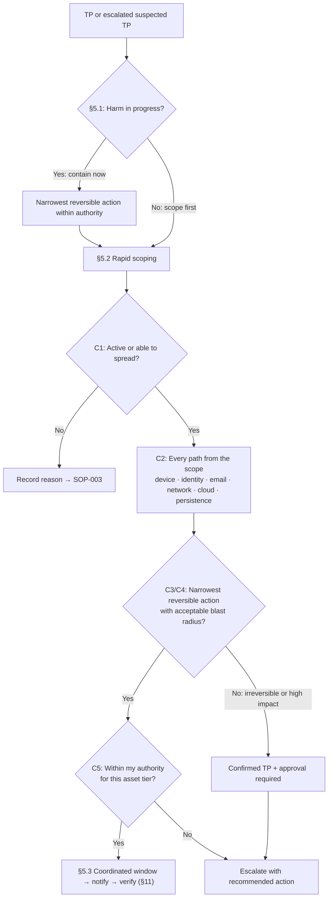

# SOP-002: Containment

| Field | Value |
|---|---|
| **SOP ID** | SOP-002 |
| **Title** | Containment: Decision, Authority and Verification |
| **Version** | 1.2 |
| **Status** | Active |
| **Owner** | Vince-SecOperations |
| **Effective date** | 2026-11-27 |
| **Next review** | 2027-05-27 |
| **Primary platform** | Microsoft Defender XDR (unified portal, with Microsoft Sentinel and Microsoft Entra ID) |
| **Environments** | On-premises, hybrid (AD + Entra ID) and cloud workloads |
| **Preceded by** | [SOP-001: Alert and Incident Triage](SOP-001-Alert-and-Incident-Triage.md) |
| **Followed by** | [SOP-003: Eradication, Remediation and Recovery](SOP-003-Eradication-Remediation-and-Recovery.md) |

---

## 1. Purpose

This SOP defines **when** to contain, **what** action to take, **who** is authorised to take it, and **how** to prove it worked. It sets rules and authority. Scenario-specific steps (phishing, business email compromise, ransomware, cloud key leak) belong in runbooks that must operate inside these rules.

## 2. Scope

- **In scope:** every true positive, and every suspected true positive escalated under SOP-001 §7.4, regardless of detection source (vendor alert, custom detection rule, threat hunt, user report). This includes removing attacker persistence that **gives ongoing access** (§8.1).
- **Out of scope:** removing persistence that does not give ongoing access, fixing the root cause and restoring service (SOP-003).

## 3. Framework alignment

| Activity | NIST CSF 2.0 | Covered by |
|---|---|---|
| Triage and validate | RS.MA-02 | SOP-001 |
| Categorise and prioritise | RS.MA-03 | SOP-001 |
| Escalate or elevate | RS.MA-04 | SOP-001 §7.4 |
| **Scope before containment** (what happened, magnitude) | **RS.AN-03, RS.AN-08** | **SOP-002 §5.2** |
| **Contain** | **RS.MI-01** | **SOP-002** |
| Eradicate | RS.MI-02 | SOP-003 |
| Apply recovery criteria / recover | RS.MA-05, RC.RP | SOP-003 |

Reference model: NIST SP 800-61 Rev. 3 (April 2025), the incident response profile of CSF 2.0.

## 4. Definitions

| Term | Definition |
|---|---|
| **Containment** | An action that stops the incident from spreading or causing further damage, without yet removing the cause. |
| **Short-term containment** | Immediate, reversible action to stop harm (isolate a device, revoke sessions, block an indicator). |
| **Long-term containment** | Temporary controls kept in place while eradication is prepared (firewall rules, conditional access block, restricted app execution). |
| **Blast radius** | The business impact of the containment action itself (for example, isolating a production server stops customer service). |
| **Reversible action** | An action that can be fully undone with no data loss (isolate/release, disable/enable, block/unblock). |
| **Pre-approved action** | An action the authority matrix (§7) allows a role to take without further approval. |
| **Asset tier** | As defined in SOP-001 §7.1 (Tier 0 identity/control plane → Tier 3 non-production). |
| **Scope** | Every entity, path and time period involved in the incident, established before containment so that containment cuts every path (§5.2). |
| **Scope window** | The period searched: from **before** the first malicious activity **to now**. |
| **Coordinated containment window** | A short period (minutes) in which every containment action for every path is executed back-to-back, so the attacker loses all access at the same moment (§5.3). |
| **Access-enabling persistence** | Anything the attacker added that lets them back in after sessions are revoked: a registered MFA or passwordless method, an OAuth app consent, a new credential, a mail forwarding rule sending data out. |

---

## 5. Entry criteria and scoping

Containment may start when **any** of the following is true:

1. SOP-001 verdict is **true positive**.
2. SOP-001 escalated a **suspected true positive** at P1/P2 **and** there is evidence of ongoing or spreading activity.
3. An automated action has already been taken (§9) and must be validated by an analyst.

> **Suspected is enough for reversible actions.** When harm is in progress (§5.1, contain now), contain first and finish the investigation after. Irreversible actions require a confirmed true positive.

### 5.1 Contain now or scope first

Decide the mode before acting, and record it (§14).

| Mode | Use when | Do |
|---|---|---|
| **Contain now** | Harm is in progress: the attacker is active in a session now; directory, mailbox, role or data changes are appearing; encryption, exfiltration or movement toward Tier 0 is under way. | Take the narrowest reversible action within authority immediately (usually revoke sessions or isolate). Then scope (§5.2) and complete the coordinated containment (§5.3). |
| **Scope first** | No harm in progress: the session is stale, or access was gained with no follow-on activity seen. | Scope (§5.2) within the timebox, then contain every path in one coordinated window (§5.3). |

**Why scope first when you can:** partial containment warns the attacker. If one path is closed while another stays open (a registered MFA method, an app consent, a second compromised account), the attacker moves to it, knowing they have been seen.

**Timebox:** scoping never pushes containment past the containment SLA in SOP-001. If scoping is not finished when the timebox ends, contain on what is known and keep scoping.

### 5.2 Rapid scoping before containment

Scoping produces the answer to C2 (§6): every path that must be cut.

1. **Entities:** use every entity observed in the incident: accounts (UPN and object ID), source IP addresses, devices, applications, user agents, session IDs, files and hashes, mailboxes.
2. **Window:** search from **before** the first malicious activity (earlier attempts with the same entities; the limit is log retention) up to **now**. Never stop at the last observed activity; persistence can act later.
3. **Breadth:** run each entity across the whole tenant (this client's tenant only, §13), not only against the affected account.
4. **Persistence check** on every compromised identity, from the start of the window:
   - authentication methods registered or changed;
   - OAuth app consents granted;
   - mailbox rules, forwarding and delegates;
   - role and group membership changes;
   - password resets or user changes performed **by** the compromised account.

   Sources: Entra admin center audit logs (or `AuditLogs` in Sentinel), the user's Authentication methods page, Exchange or Purview audit.
5. **Iterate:** every new entity found (another account, a new IP, a new device, a new method) becomes the next pivot. Scoping is complete when a round of pivots finds nothing new, or the timebox ends.
6. **Record** the entities, window, queries and findings in the case file.

```kql
// Scoping template: every observed entity, tenant-wide, from before first activity to now
let window_start = datetime(YYYY-MM-DD HH:MM:SS);   // earlier than the first malicious activity (UTC)
let ips      = dynamic(["x.x.x.x", "y.y.y.y"]);     // every observed source IP
let accounts = dynamic(["<AccountObjectId>"]);      // every observed account
EntraIdSignInEvents
| where Timestamp > window_start
| where IPAddress in (ips) or AccountObjectId in (accounts)
| summarize Attempts = count(), Successes = countif(ErrorCode == 0),
            First = min(Timestamp), Last = max(Timestamp)
            by AccountUpn, IPAddress, Application
| order by First asc
```

For device entities, run the same pattern on `DeviceNetworkEvents`, `DeviceProcessEvents` and `DeviceLogonEvents`; for email, on `EmailEvents` and `EmailUrlInfo`.

### 5.3 Coordinated containment window

After scoping, execute every containment action for every path back-to-back, in one short window, so every route the attacker has closes at the same moment.

1. **Prepare first.** List each action, the entity it applies to, who executes it and the approval needed (§7). Obtain approvals **before** the window opens.
2. **Order for a compromised identity:**
   - if disabling is approved, **disable first**: it holds every route closed while the rest is done;
   - otherwise: remove access-enabling persistence (attacker-registered methods, malicious app consents) → reset password → revoke sessions → mark user compromised → block indicators;
   - for the matching device path, isolate in the same window.
3. **Do not tip off the attacker.** Keep incident communications off channels the attacker may be reading (the compromised mailbox, Teams chats, shared documents). Contact the affected user out-of-band (phone or in person), and verify the caller: attackers impersonate IT.
4. **Record** the UTC time of every action (§10) and verify (§11).

---

## 6. The Containment Decision Test

Answer in order. Record the answers in the case file.

| # | Question | Guides |
|---|---|---|
| **C1** | **Is it active or able to spread?** (Ongoing C2, lateral movement, active session, malicious email still in mailboxes, valid stolen credential, attacker-registered authentication method.) | If **no** (single blocked event, no follow-on activity): containment may not be needed. Record why and move to SOP-003. |
| **C2** | **What must be cut?** Use the scope (§5.2) to identify every attacker path: device, identity, email, network indicator, cloud resource, access-enabling persistence. | Choose actions that cut **every** path; containing the device but not the stolen account leaves the attacker in. |
| **C3** | **What is the blast radius of the action?** | Tier 0/1 assets: business owner must be informed or approve (§7). Prefer the narrowest action that stops the harm. |
| **C4** | **Is the action reversible?** | Reversible → can proceed on suspected TP. Irreversible (hard delete, wipe, account deletion) → confirmed TP and approval only. |
| **C5** | **Do I hold authority for this action on this tier?** | Check §7. If not → escalate with a recommended action. Never act outside authority, even under time pressure. |

### 6.1 Decision flow



### 6.2 Containment ladder

Start at the **lowest rung that cuts every path identified in C2**. Climb only if verification (§11) shows activity continuing.

| Rung | Action | Tool | Executed by | Service impact |
|---|---|---|---|---|
| **1. Identity** | Remove access-enabling persistence, reset password, revoke sessions, mark compromised, disable account | Defender XDR / Entra ID / Defender for Identity | SOC | None to the service |
| **2. Indicator** | Block C2 / exfiltration destination, URL, domain, hash | Defender custom indicators; perimeter firewall | SOC (Defender); network team (firewall) | None |
| **3. Process / file** | Stop and quarantine file, kill process | Defender XDR; live response | SOC | Minimal |
| **4. Isolate in place** | Cut everything except the flows the business needs | **Workstations:** Defender selective isolation with pre-defined isolation exclusion rules. **Servers:** per-asset NSG / security group / firewall allow-list | SOC (Defender); network or cloud team (NSG / firewall) | Service continues |
| **5. Drain or fail over, then fully isolate** | Remove the node from traffic, move service to a verified target (SOP-003 §8.2), then fully isolate the node | Load balancer / cluster / DR platform, then Defender | IT operations drains or fails over; SOC then isolates | Brief failover or reduced capacity |
| **6. Full isolation in service** | Fully isolate a node that has no redundancy | Defender full isolation, or network disconnect for unmanaged assets | SOC, after the service owner accepts the downtime | Service down; continuity per SOP-003 §8 |

**Rules**

1. **Workstations go straight to rung 4 or 6.** The user moves to a loaner (SOP-003 §8.1); no business approval or scheduling is needed.
2. **The SOC cannot drain or fail over.** Defender XDR has no load-balancer or failover function. The SOC requests rung 5 on the incident bridge; IT operations executes it under an emergency change.
3. **Active-harm override.** If encryption, data exfiltration or movement toward Tier 0 is in progress, the IR lead may authorise rung 6 on a Tier 1 asset immediately and inform the business owner afterwards. This authority must be pre-agreed in the organisation's IR plan.
4. **Isolation exclusions are prepared, not improvised.** In Defender, full isolation allows no exceptions. Selective isolation applies the global isolation exclusion rules (Settings → Endpoints → Advanced features → Isolation Exclusion Rules). Rule changes apply only to new isolation requests, so a device must be released and re-isolated to pick them up. Teams and Outlook are not excluded by default and must be defined if users need them.
5. **Exclusion rules are global.** Use them for flows every isolated workstation needs (management, collaboration). Per-server business flows belong in network rules owned by the network or cloud team.
6. **Rung 1 for an identity is one coordinated set, not a menu.** Removing persistence, resetting the password and revoking sessions are executed together in the coordinated window (§5.3); any one of them alone leaves a route open.

---

## 7. Authority matrix

**Legend:** ✅ pre-approved · 🔔 pre-approved, notify asset owner immediately · 🟡 requires L2/L3 or IR lead approval · 🔴 requires incident commander **and** business owner approval · ❌ not permitted

### 7.1 Tier 2/3 assets (workstations, non-production, standard users)

| Action | L1 | L2 | L3 / IR lead |
|---|---|---|---|
| Stop and quarantine file | ✅ | ✅ | ✅ |
| Block indicator (hash, URL, domain) | ✅ | ✅ | ✅ |
| Soft-delete malicious email across mailboxes | ✅ | ✅ | ✅ |
| Collect investigation package | ✅ | ✅ | ✅ |
| Isolate device (full or selective) | 🔔 | ✅ | ✅ |
| Revoke sessions / require re-sign-in | 🔔 | ✅ | ✅ |
| Mark user as compromised (Entra risk = high) | 🟡 | ✅ | ✅ |
| Remove attacker-registered authentication method | 🟡 | ✅ | ✅ |
| Reset password / reset authentication | 🟡 | 🔔 | ✅ |
| Disable user account | 🟡 | 🔔 | ✅ |
| Restrict app execution | 🟡 | ✅ | ✅ |
| Block IP address or range | 🟡 | ✅ | ✅ |
| Hard-delete email | ❌ | 🟡 | ✅ |
| Live response (run scripts, remove files) | ❌ | 🟡 | ✅ |

### 7.2 Tier 0/1 assets (identity infrastructure, production, privileged accounts)

| Action | L1 | L2 | L3 / IR lead |
|---|---|---|---|
| Collect investigation package | ✅ | ✅ | ✅ |
| Block indicator (hash, URL, domain) | ✅ | ✅ | ✅ |
| Stop and quarantine file | 🟡 | 🔔 | ✅ |
| Revoke sessions (privileged account) | 🟡 | 🔔 | ✅ |
| Mark privileged user as compromised | 🟡 | 🔔 | ✅ |
| Remove attacker-registered authentication method (privileged account) | ❌ | 🔔 | ✅ |
| Reset password / reset authentication (privileged account) | ❌ | 🟡 | 🔔 |
| Isolate production server (Tier 1) | ❌ | 🟡 | 🔴 |
| Disable privileged / service account, or block its sign-in | ❌ | 🟡 | 🔴 |
| Any action on a domain controller or identity system (Tier 0) | ❌ | ❌ | 🔴 |
| Mass action (more than 10 devices or users) | ❌ | 🟡 | 🔴 |
| Disable emergency access (break-glass) account | ❌ | ❌ | ❌ |

### 7.3 Rules

1. **The matrix is the ceiling, not the target.** Take the narrowest action that stops the harm.
2. **Time pressure does not widen authority.** If an action is outside your authority, escalate with a recommended action and the evidence; record the time you escalated.
3. **Notify means immediately**, by the channel defined for the asset owner, not at shift end.
4. **Never disable break-glass accounts or the accounts running the security tooling.** Restrict and monitor them instead, under IR lead direction.
5. **Authority is also technical.** Check the Entra role needed before the coordinated window opens: for example, disabling an account that holds an admin role needs Privileged Authentication Administrator; User Administrator is not enough. A missing permission discovered mid-window leaves a route open.

---

## 8. Containment actions by environment

| Path | On-premises / hybrid | Cloud (Entra ID / Microsoft 365) | Cloud workloads (Azure / AWS / GCP VMs) |
|---|---|---|---|
| **Device** | Defender: isolate device (full, or selective with isolation exclusion rules), restrict app execution, contain device (for devices not onboarded) | — | Defender isolation if onboarded; otherwise network security group / security group / firewall rule allowing only management traffic. **Snapshot the disk first.** |
| **Identity** | Disable in AD (Defender for Identity action or AD directly); reset password | Remove attacker-registered methods, reset password, revoke sessions, mark compromised, disable in Entra ID, block sign-in with conditional access | Disable/rotate cloud IAM credentials, access keys, service principal secrets |
| **Email** | — | Soft-delete across mailboxes, block sender/domain in Tenant Allow/Block List, remove malicious inbox rules and forwarding | — |
| **Network** | Firewall/proxy block | Defender custom indicators (IP, URL, domain) | Cloud firewall / security group deny rules |

### 8.1 Identity containment rules (cloud and hybrid)

1. **Hybrid: disabling or resetting in on-premises AD does not take effect in Entra ID until the next directory sync.** Also act in Entra ID: revoke sessions and block sign-in.
2. **A password reset does not end every session.** An admin reset revokes the refresh tokens and cookies issued from the password, but a browser session cookie not issued from the password stays alive. Revoke sessions revokes all refresh tokens. Always pair a reset with revoke sessions.
3. **Access tokens already issued stay valid until they expire**, unless the application supports Continuous Access Evaluation. Verification must allow for this (§11).
4. **Access-enabling persistence is removed inside the coordinated window, not deferred:** attacker-registered MFA or passwordless methods, malicious OAuth app consents, forwarding rules sending data out. Other persistence findings (for example, group memberships that grant nothing further) are recorded for SOP-003.
5. **Mark the user as compromised** in Entra ID Protection (*Confirm user compromised*) so risk-based conditional access treats the account as high risk.
6. **Contact the affected user out-of-band** (phone or in person, never the compromised mailbox or Teams), and verify the caller's identity both ways.

---

## 9. Detection source and automation

The containment rules are the **same** for vendor alerts and custom detections. What differs is automation.

### 9.1 Vendor alerts

1. **Check the Action Center first.** Automated investigation and response, or automatic attack disruption, may already have contained devices or users.
2. **Validate, don't duplicate or undo.** Confirm each automated action fits the evidence; record it as a containment action in the case file.
3. **If an automated action caused unacceptable business impact**, escalate to L2/L3 before reversing it.

### 9.2 Custom detection rules

Custom detection rules in Defender XDR can carry automated response actions (isolate device, collect investigation package, run antivirus scan, initiate investigation, restrict app execution, quarantine or block file, mark user compromised, disable user, reset user authentication, move or delete email).

An automated action may be attached to a custom rule **only if all** of the following are true:

| # | Condition |
|---|---|
| 1 | The rule has run in alert-only mode for a tuning period (lab default: 30 days) with **no false positives**. |
| 2 | The action is **reversible** and appears in the L1 ✅ column of §7.1. |
| 3 | The rule is scoped to **Tier 2/3 device groups**. Never auto-isolate or auto-disable Tier 0/1. |
| 4 | The rule and action are documented (rule name, query version, action, owner, review date). |
| 5 | Every automated action still raises an alert that an analyst reviews under this SOP. |

---

## 10. Evidence before and during containment

1. **Collect the investigation package before or immediately after isolating.** Isolation keeps the device connected to Defender, so collection still works.
2. **Do not power off or reboot** a compromised device unless the IR lead directs it; memory evidence is lost.
3. **Snapshot cloud VM disks** before changing network rules or stopping instances.
4. **Record the exact time of each action (UTC).** It is the reference point for verification (§11).
5. **Export identity evidence before it ages out.** Entra sign-in and audit logs are retained for 30 days on P1/P2 (7 days on Free). Export the scoping results and audit entries to the case file.

---

## 11. Verify containment

Containment is not complete until a query shows the activity stopped.

```kql
// Device / network: did activity continue after containment? Expect zero rows.
let contained_at = datetime(YYYY-MM-DD HH:MM:SS);   // time of containment action (UTC)
let ioc_ip = "x.x.x.x";
let host   = "device-name";
DeviceNetworkEvents
| where Timestamp > contained_at
| where RemoteIP == ioc_ip or DeviceName =~ host
| where ActionType == "ConnectionSuccess"
| project Timestamp, DeviceName, RemoteIP, RemotePort, InitiatingProcessFileName
```

```kql
// Identity: any successful sign-in after containment?
// Keep non-interactive sign-ins: token refreshes by the attacker appear there.
let contained_at = datetime(YYYY-MM-DD HH:MM:SS);   // end of the coordinated window (UTC)
let account_id   = "<AccountObjectId>";
EntraIdSignInEvents
| where Timestamp > contained_at
| where AccountObjectId == account_id
| where ErrorCode == 0
| project Timestamp, IPAddress, Country, Application, LogonType, UserAgent, IsManaged, IsCompliant
| order by Timestamp asc
```

For identity containment, expect **no successful sign-ins from any attacker source**. The legitimate user signing in again after the reset is expected; separate it by source, device and the out-of-band confirmation. Run the identity check immediately, again after access tokens have expired (allow 90 minutes), and again at 24 hours. For on-premises identities, also check `IdentityLogonEvents`. For cloud workloads, verify through flow logs or provider audit logs.

**If activity continues:** a path was missed (C2). Return to §5.2.

---

## 12. Communication

| Audience | When | Content |
|---|---|---|
| Asset owner | On every 🔔 / 🔴 action | What was contained, why, expected impact, contact |
| Affected user | After identity containment, out-of-band (§8.1) | Account action taken, what to expect, how to verify contact is genuine |
| Incident commander / IR lead | On every P1, any Tier 0/1 action | Status, actions, open risks |
| Client (MSSP) | Per contract notification SLA | See §13 |

All incident communications use channels the attacker cannot read (§5.3).

---

## 13. MSSP operation

1. **Each client has its own rules of engagement**: the list of response actions the provider is authorised to take, on which asset groups, and who approves anything else.
2. **Actions not on the client's authorised list are recommendations only.** Send them with evidence and wait for client approval.
3. **If the client is unreachable on a P1**, follow the contract's default-action clause; if none exists, take only reversible actions that are on the authorised list and continue to escalate.
4. **Never apply one client's rules to another client.** Scoping (§5.2) runs inside the affected client's tenant only.

---

## 14. Record

Add to the case file:

```
MODE: <contain now / scope first> — reason: <...>
SCOPE: window <start UTC> → <end UTC> · entities <...> · tenant-wide result <...> · persistence found <...>
CONTAINMENT DECISION: C1 <active?> · C2 <paths> · C3 <blast radius> · C4 <reversible?> · C5 <authority>
LADDER RUNG: <1–6> — reason a lower rung was not enough: <...>
COORDINATED WINDOW: <start UTC> → <end UTC>
ACTIONS: <action> on <entity> at <UTC time> by <role> (approval: <name / pre-approved>)
AUTOMATED ACTIONS VALIDATED: <action / none>
EVIDENCE COLLECTED: <investigation package / snapshot / log export / none + reason>
VERIFICATION: <query / result / time> · re-checked at <+90 min> and <+24 h>
NOTIFIED: <who, when, channel>
METHOD: SOP-002 v1.2
```

---

## 15. References

- NIST Cybersecurity Framework 2.0: Respond function (RS.MA, RS.AN, RS.MI)
- NIST SP 800-61 Rev. 3: Incident Response Recommendations and Considerations for Cybersecurity Risk Management (April 2025)
- Microsoft Learn: Incident response overview (Microsoft Security)
- Microsoft Learn: Revoke user access in an emergency in Microsoft Entra ID
- Microsoft Learn: Refresh tokens in the Microsoft identity platform (token revocation)
- Microsoft Learn: Investigate risk with Microsoft Entra ID Protection
- Microsoft Learn: Microsoft Entra data retention
- Microsoft Learn: Take response actions on a device
- Microsoft Learn: Isolation exclusions in Microsoft Defender for Endpoint
- Microsoft Learn: Create and manage custom detection rules (automated response actions)
- Microsoft Learn: Automatic attack disruption in Microsoft Defender XDR

---

## Revision history

| Version | Date | Author | Change |
|---|---|---|---|
| 1.0 | 2026-11-22 | Vince-SecOperations | Initial release |
| 1.1 | 2026-11-22 | Vince-SecOperations | Added containment ladder (§6.2) with executing team per rung, active-harm override and Defender isolation exclusion rules; ladder rung added to record |
| 1.2 | 2026-11-27 | Vince-SecOperations | From CASE-15 lessons: contain-now vs scope-first decision (§5.1); rapid scoping with full scope window, all entities and tenant-wide pivots (§5.2); coordinated containment window (§5.3); persistence added to C1/C2 and the decision flow; privileged identity actions added to the authority matrix (§7.2) with a technical-permission rule (§7.3); identity rules corrected for token behaviour and extended to cloud-only tenants (§8.1); log-export rule (§10.5); identity verification query and re-check schedule (§11); mode, scope and window fields in the record (§14) |
